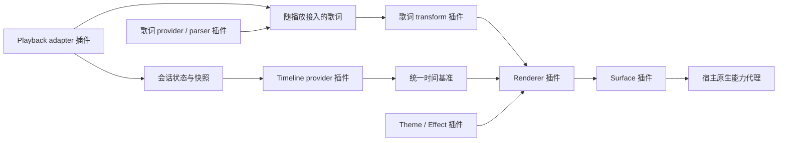

# Lyrscape 插件架构草案

状态：目标架构提案。2026-10-13 已实现可信插件宿主与基础组合；隔离、包安装和完整 manifest 等仍为后续设计。实际范围见 [第一版说明](baseline.md)。原设计日期：2026-10-12。

## 1. 原则

**All product features are plugins.** 内置 adapter、歌词解析器、时钟策略、渲染器、桌面视图与设置页面均通过公开 SDK 注册；第三方能够替换它们，不依赖一个不可替换的默认歌词组件。

保留最小 kernel 是插件系统成立的条件。它负责执行契约与运行机制，不决定歌词从哪里来、如何显示、怎样动画或选择哪个播放器。

| Kernel 固定机制 | 插件贡献的策略与功能 |
| --- | --- |
| 插件安装记录、manifest 校验、依赖图、版本匹配与生命周期 | 播放 adapter、歌词 provider/parser/transform |
| 服务注册、会话标识、消息路由、修订号与写入者 lease | 会话选择、歌词匹配、延迟校准与时间估算策略 |
| 单调时钟原语、快照分发与宿主窗口原语 | timeline provider、overlay/stage/controller 等 surface |
| 文件/网络/窗口等能力代理、命名空间存储与资源追踪 | renderer、theme、effect、visualizer、设置与命令 |
| 启动故障恢复、安全模式与最小恢复入口 | 普通插件管理界面、托盘菜单内容与快捷键绑定 |

恢复入口只支持查看错误、禁用插件、恢复官方组合与退出；当设置 UI 插件损坏时，用户仍可恢复。正常产品界面全部由插件提供。

## 2. 数据流与服务组合



AMLL、SMTC 等 adapter 对外发布统一的会话事件。宿主没有 AMLL 专用状态字段；AMLL 原始消息与协议版本仅存在于 adapter 内部。

宿主负责注册和路由，服务选择由配置/编排插件控制。一个会话同一时刻只允许一个播放状态写入者和一个 timeline provider；同一个物理窗口只有一个 surface owner。多个独立会话可以并行存在。切换 provider 用 lease/generation 原子交接，旧实例的迟到事件失效。

歌词解析和渲染能力通过带版本的 service ID 发现，例如 `lyrscape.lyrics.parser@1`、`lyrscape.timeline@1`。需要必备服务的插件声明依赖并等待就绪；可选服务通过探测降级。缺少必备依赖、版本不符、循环依赖必须给出可定位的错误，不静默使用不兼容服务。

## 3. 插件类型

| 贡献点 | 职责 | 示例 |
| --- | --- | --- |
| playback-adapter | 接入播放器状态，可选控制能力与随附歌词 | AMLL WS、SMTC、浏览器桥接 |
| lyric-provider | 按曲目获取歌词，与播放器连接方式无关 | 本地目录、用户配置的数据源 |
| lyric-parser | 解析原始格式为统一文档 | LRC、TTML、增强 LRC |
| lyric-transform | 显式处理链，保留原始文档 | 延迟修正、翻译、音译、分词 |
| timeline-provider | 从采样计算会话时间基准 | 直接同步、插值、平滑漂移修正 |
| renderer | 负责歌词排版、字进度与动画 | 经典双行、自定义 Canvas、AMLL 风格 |
| theme / effect | renderer 声明支持的样式参数或效果钩子 | 字体主题、粒子、渐变、发光 |
| surface | 承载 renderer，管理视图布局和交互 | 桌面 overlay、舞台、控制面板 |
| visualizer | 消费可用音频/频谱数据 | 频谱与音频响应效果 |
| settings / command | 设置页面、可配置命令与菜单贡献 | 插件管理、快捷键、配置预设 |

一个插件包可以贡献多种能力，但每种贡献有独立 ID 和运行入口。插件可自由选择 Web 前端框架。

当前可信注册表已标注主要能力分类，并实现管理 UI、可选插件启停、声明式配置及 renderer 选择；见 [实现说明](plugins.md)。分类是贡献元数据，不要求用不同基类继承。当前 Aurora 把动画作为 renderer 内部能力，通用 effect 插槽与多个贡献点的完整 manifest 仍未实现。

Theme/effect 不假设所有 renderer 都有 DOM。Renderer 声明 `dom-css`、`canvas-overlay`、`shader-pass` 等扩展槽和参数 schema，插件按兼容性挂接；不兼容的效果不能靠修改其他插件私有 DOM 强行运行。允许一个完整 scene 插件组合 renderer、背景和效果，也允许完全替换 renderer。

## 4. 统一数据契约

所有时间均为毫秒。SDK 使用 Lyrscape 自有模型，不直接暴露 AMLL 或 SMTC 类型。

- **Session**：宿主分配的 `sessionId`、adapter 实例、连接状态、会话 generation。
- **Track**：`trackRevision`、本地 `trackKey`、带来源的外部 ID、标题、艺人、可选时长/封面。外部 ID 不假定跨平台相同。
- **PlaybackSample**：会话与曲目修订、`positionMs`、宿主单调域中的 `observedAtMonoMs`、可选播放状态/速率、同步质量。字段缺失表示未知；来源默认值必须标明是估计。
- **LyricDocument**：`timingMode: none | line | word`、独立 `lyricRevision`、正文行、可选行/字词时间、翻译、音译、背景声与歌手标记、来源信息。原始内容不可变，transform 生成新修订。
- **TimelineAnchor**：`positionMs`、`anchorMonoMs`、播放状态/速率、校准偏移、revision 和数据年龄；为所有视图提供共同基准。
- **Capabilities**：每个实例动态声明 `seek`、`pause`、`resume`、歌词、音频等能力；不存在的能力不能显示为可用控制。支持协议指令不等于发送端实际实现该指令。

未提供逐字时间时按逐行或静态文本显示，不用平均分配字符时长伪装真实逐字歌词。保留 TTML 特殊元数据的扩展命名空间，具体映射规则留给 parser 插件版本定义。

切歌递增 trackRevision，清空旧歌词/封面/时间基准；异步歌词结果必须携带查询时的修订号。换 adapter 或重连递增 generation，旧连接回调不能污染新会话。AMLL 接收顺序之外若缺少曲目关联信息，adapter 不虚构协议无法提供的保证。

## 5. 时间策略

AMLL adapter 优先接受播放器直接发送的进度。时钟插件解决两次采样之间的逐帧显示、暂停、seek、断线以及用户校准，不能制造来源不存在的精度。

播放中的基本估计为 `positionMs + (nowMonoMs - anchorMonoMs) * rate`；暂停或状态未知时不盲目推进。小幅偏差可由策略平滑修正，seek/切歌/重连必须重新锚定，不能把 seek 当作漂移慢慢追赶。偏移的符号和叠加次序由 SDK 固定，实际偏移设置由插件管理。

时间策略输出 anchor，不通过全局事件总线每帧广播时间。每个 view realm 用同一 anchor 本地采样并驱动 requestAnimationFrame；宿主代理负责不同 JS realm 的单调时钟域换算及校准。窗口恢复、系统休眠后刷新快照。频谱/PCM 使用独立流和背压，不挤占歌曲状态消息。

## 6. Manifest 与生命周期

Manifest 包含插件 ID、版本、SDK 范围、支持的平台、贡献入口、依赖/服务版本、配置 schema 和所请求的权限范围。[示例](../examples/amll-adapter/plugin.json) 是提案格式，没有对应实现和正式 JSON Schema。

状态机：`discovered → validated → resolved → activating → active → deactivating → inactive`；任一步失败进入 `failed`，保留错误和可恢复配置。

依赖拓扑排序后激活，退出时逆序释放。SDK 的订阅、timer、窗口、网络监听器、文件句柄和 service registration 都归属于插件实例 scope。插件退出时宿主强制撤销 scope，不只相信插件自己执行 dispose。激活中途失败也回滚已获得的资源；提供者替换失败时保留上一份可用快照并尝试恢复原提供者。

开发期支持重载；发布期卸载、版本迁移和依赖回滚需在文件写入完成后原子切换。不可依赖插件 ID 前缀推断可信身份。官方插件也声明和使用相同的公共能力接口。

## 7. 执行边界

- **逻辑插件**：首选隔离 Worker/WASM；不接触宿主 UI 全局变量。Worker 没有 DOM 不代表自动隔离网络或完整防护，权限仍需受控来源、CSP 和能力代理共同实现。
- **视觉插件**：独立受限 WebView/iframe，使用消息接口访问选定会话；不注入任意 Tauri invoke 权限。用户自己的可信开发插件可选择更宽的开发权限，但该选择不能默认为第三方包。
- **原生能力**：通过 Rust 宿主 broker 提供窄接口。SMTC、窗口与本地 WS 监听等平台 backend 初期随宿主构建成模块，功能 adapter 本身仍通过插件接口工作。随意安装任意 Rust DLL 不列入第一版；未来需要原生第三方扩展时使用受控 sidecar，并单独验证平台权限与进程隔离。

逻辑与视觉贡献可以在不同 realm 中运行，通过带实例身份的 SDK 协议协作。拒绝插件伪造其他实例身份、读写其他命名空间或取得未授权的原生能力。修改网络/文件/播放控制权限后，宿主即时撤销相关 lease。

视觉插件异常时可替换为备用 renderer；无限循环需要外部 watchdog，GPU/进程耗尽不能只靠 try/catch。是否采用独立 WebView 或进程，以及可接受的帧预算，要通过 overlay 原型测量后确定。

## 8. 默认插件组合

```text
Lyrscape kernel + platform broker
  official.adapter.amll       → 播放信息 / 可选随附歌词
  official.parser.lrc         → 逐行歌词
  official.parser.ttml        → 逐字歌词
  official.timeline.default  → 共享时间基准
  official.renderer.classic  → 基础逐行/逐字显示
  official.surface.overlay   → 桌面视图
  official.theme.default     → 默认主题
  official.ui.settings       → 正常设置与插件管理
```

这些 ID 是拟定的内置插件清单，不表示插件已经存在。首版必须用第三方示例替换默认 renderer，并用另一种 adapter 驱动同一 overlay，验证抽象确实可替换。

## 9. 取舍

优点：输入与视觉独立演进，用户能组合、替换、分享场景；内置插件为 SDK 提供真实样例。

成本：开发启动速度、依赖协调、版本兼容、进程/窗口资源占用、插件故障诊断都会比单体应用复杂。先完成小规模公共契约与最小可用组合，再建设商店或广泛的插件兼容承诺。
